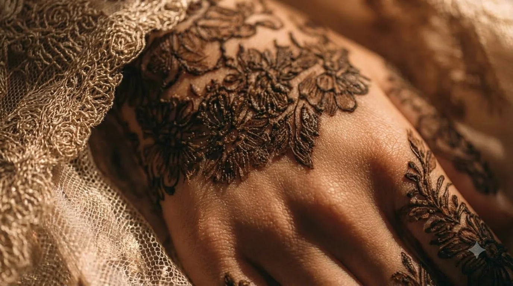
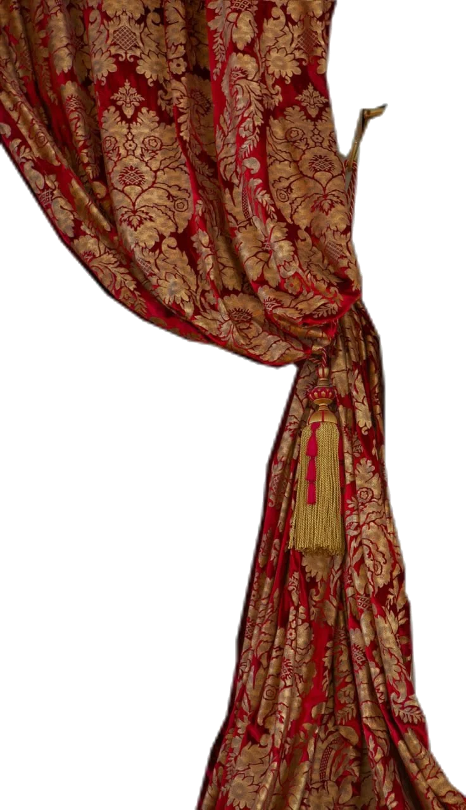
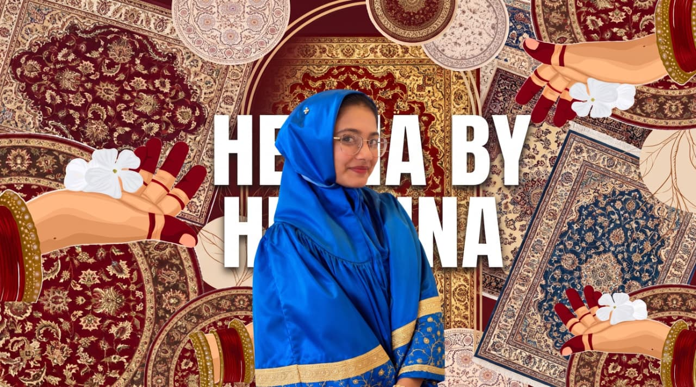

<div align="center">
  

  # ✨ HUSAINA Mehndi Atelier ✨

  *Bespoke Bridal & Contemporary Henna — Handcrafted with pure devotion for your sacred celebrations.*

  [](https://henna-by-husaina.vercel.app)
  [](#)
  [](#)
  [](#)
  
  <br />

  **[View Live Website](https://henna-by-husaina.vercel.app)** 
</div>

---

## 🥀 About The Atelier

Welcome to **Husaina Mehndi Atelier**, an exquisite digital showcase of contemporary and traditional mehndi artistry. This beautifully crafted, high-performance portfolio is designed to bring the elegance and precision of henna design into the digital world, capturing the essence of bridal beauty and storytelling.

We use 100% organic, triple-sifted Sojat leaves, soothing Bulgarian lavender oil, and eucalyptus. No synthetic chemicals, no artificial dyes—just pure, deep-staining, botanical artistry.

## 🌟 Key Features

- **Theatrical Curtain Reveal:** A breathtaking cinematic curtain-opening experience upon scrolling to the signature portfolio.
- **Immersive 3D Photo Carousel:** A stunning interactive 3D gallery to browse intricate designs, custom-built for fluid performance.
- **Cinematic Video Integration:** High-quality background video sections that bring the living craft to your screen without compromising on performance.
- **Scroll Dissolve Magic:** Beautiful image-morphing transformation sections revealing the magic of the henna stain process.
- **Instant WhatsApp Booking:** Integrated seamless booking system redirecting clients straight to WhatsApp.
- **Responsive & 60FPS Optimized:** Carefully optimized across all viewports to ensure buttery smooth scrolling and animations.

## 📸 Glimpse of the Art

| Bridal Suites | Organic Botanicals | Custom Storytelling |
|:---:|:---:|:---:|
|  |  |  |

## 🛠️ Tech Stack

- **Core:** React 18, Vite, TypeScript
- **Styling:** Tailwind CSS
- **Animations:** Framer Motion, GSAP
- **Icons:** Lucide React
- **Deployment:** Vercel

## 🚀 Local Development

1. **Clone the repository:**
   ```bash
   git clone https://github.com/juzer09jawadwala-source/henna-by-husaina.git
   cd henna-by-husaina
   ```

2. **Install dependencies:**
   ```bash
   npm install
   ```

3. **Start the development server:**
   ```bash
   npm run dev
   ```

---

<div align="center">
  <p>Handcrafted with ❤️ & 🌿 for Husaina Mehndi Atelier.</p>
</div>
